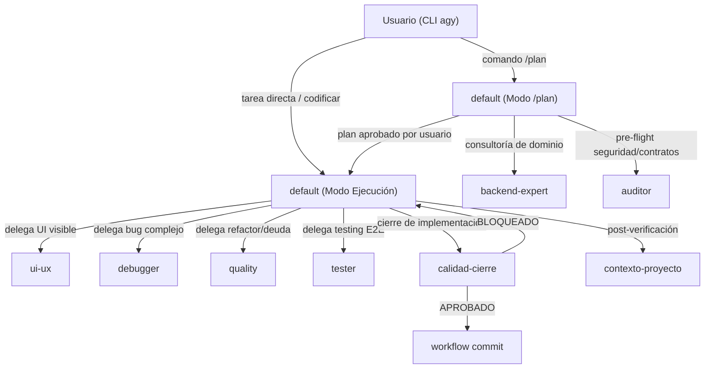
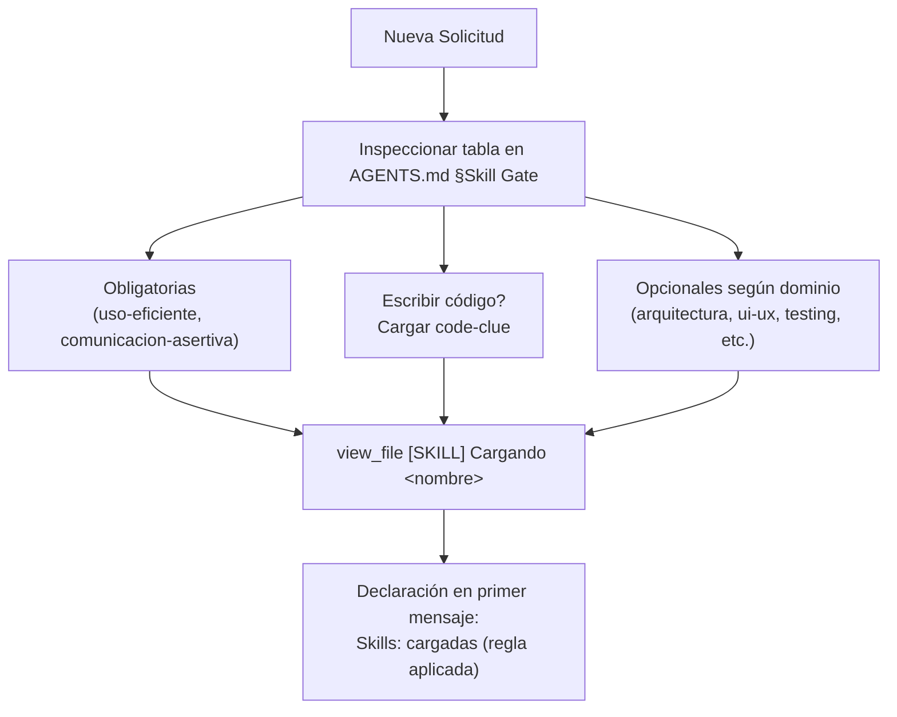
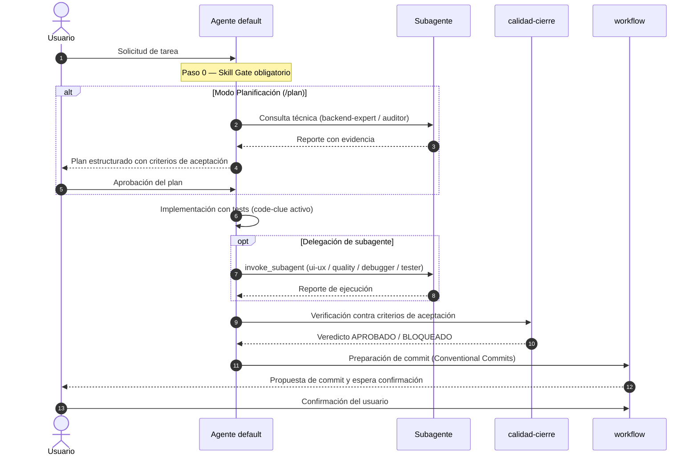

# Pipeline de Ejecución de Tareas — Antigravity CLI

> **Fecha:** 2026-10-17 · **Estado:** vigente · **Plataforma:** Google Antigravity CLI (`agy`) v1.4+
> **Para quién:** dev junior — secciones directas, tablas y diagramas; lectura rápida.
> **Estado del harness:** el agente principal de sesión es `default` (con modo dual: ejecución directa o `/plan` orquestado por `GEMINI.md`). Los 6 subagentes especializados (`ui-ux`, `backend-expert`, `auditor`, `debugger`, `quality`, `tester`) se delegan exclusivamente mediante `invoke_subagent`. Inventario vigente en [estado-actual.md](estado-actual.md); presupuestos en [presupuestos.md](presupuestos.md).
> Regla de oro: **enlazar, no copiar**. La tabla del Skill Gate reside canónicamente en `AGENTS.md` §Skill Gate; aquí solo se referencia su mecánica.

---

## 2. Pipeline por Actor y Orquestación

### Fases del Flujo

1. **Fase 1 — Inicio y Recepción**:
   - El usuario inicia su sesión en `agy` (`Antigravity CLI`).
   - El agente `default` recibe la solicitud y evalúa el **Skill Gate** antes de leer o editar cualquier archivo.
   - En toda tarea carga obligatoriamente `uso-eficiente` y `comunicacion-asertiva`.

2. **Fase 2 — Modo `/plan` (Planificación Estricta)**:
   - Activado cuando el usuario ejecuta `/plan` o pide un plan explícito.
   - **Regla estricta**: Evidencia primero (`grep`, `glob`, `view_file`); **nunca edita código ni muta archivos**.
   - Consulta dudas de arquitectura a `backend-expert` o pre-flight a `auditor`.
   - Entrega pasos numerados donde cada paso es una unidad de commit independiente con criterios observables.
   - Si la tarea abarca múltiples sesiones, genera o actualiza el feature-spec en `docs/features/NNN-<slug>.md` (`scripts/new-feature.ps1`).

3. **Fase 3 — Implementación y Delegación Especializada**:
   - El agente `default` implementa respetando la arquitectura del proyecto y añadiendo comentarios inline naturales (`code-clue`).
   - Delega mediante `invoke_subagent` según especialidad:
     - Frontend y diseño visual visible: delega a `ui-ux`.
     - Bug complejo o intermitente: delega a `debugger`.
     - Refactoring seguro verificado con tests o profiling: delega a `quality`.
     - Pruebas de navegación e integración E2E: delega a `tester`.
   - Los subagentes nunca editan código fuera de su ámbito ni se delegan entre sí; reportan sus hallazgos y el agente principal consolida.

4. **Fase 4 — Calidad de Cierre (Gate Final)**:
   - Al concluir los pasos técnicos, se evalúa la skill `calidad-cierre`.
   - Emite exclusivamente `APROBADO` o `BLOQUEADO` contrastando evidencia contra los criterios de aceptación.
   - Si el proyecto usa cerebro documental, `contexto-proyecto` actualiza los archivos afectados en `docs/project-brain/`.

5. **Fase 5 — Entrega y Commit (`workflow`)**:
   - Se revisa el `git diff`, se comprueba ausencia de secretos y se propone un Conventional Commit atómico.
   - El agente espera confirmación explícita del usuario antes de proceder.

---

## 3. Mecánica del Skill Gate en Antigravity CLI

Las skills no se precargan todas juntas en el prompt para evitar saturar el context window. Se descubren mediante metadatos ligeros (*progressive disclosure*) y su cuerpo se carga bajo demanda.

- **Protocolo de Badges en la TUI**: Las acciones mostradas en la consola Antigravity (`toolAction`) deben seguir la taxonomía oficial:
  - `[SKILL] Cargando <nombre>`: Exclusivo para lectura física de `SKILL.md`.
  - `[CMD] <descripción>`: Ejecución de comandos de terminal con `run_command`.
  - `[FILE] <acción> <archivo>`: Lectura o edición de código y documentación.
  - `[TEST] <suite>`: Ejecución y validación de pruebas.
  - `[SUBAGENT] <nombre>`: Invocación de subagentes especializados.

---

## 4. Matriz de Agentes y Responsabilidades

| Agente | Tipo | Ámbito de Edición | Responsabilidad Principal |
| :--- | :--- | :--- | :--- |
| **`default`** | Primary (Sesión) | Código y Documentación | Orquestador principal: implementa features, resuelve tareas y coordina modo `/plan`. |
| **`ui-ux`** | Subagent | Solo Frontend | Diseño, maquetación, accesibilidad (WCAG 2.2 AA) y doctrina Impeccable. |
| **`backend-expert`** | Subagent | Solo Lectura (nada) | Razona dominio, invariantes, contratos de API y arquitectura limpia. |
| **`auditor`** | Subagent | Solo `*.md` | Auditoría pre-merge de seguridad, rendimiento, patrones y documentación. |
| **`debugger`** | Subagent | Código | Diagnóstico hasta la causa raíz con método científico y test de regresión. |
| **`quality`** | Subagent | Código | Refactoring seguro, reducción de deuda técnica y optimización de cuellos de botella. |
| **`tester`** | Subagent | Solo Lectura (nada) | Pruebas funcionales E2E con browser interactivo y suites existentes. |

---

## 5. Ciclo de Vida de una Tarea

---

## 6. Scripts y Pipelines del Harness

El harness proporciona 4 herramientas principales en `scripts/` para la gobernanza del repositorio:

| Script | Propósito | Cuándo se ejecuta |
| :--- | :--- | :--- |
| **`.\scripts\harness-budget.ps1`** | **Guardarraíl de presupuesto**: Fiscaliza líneas de código, topes de `AGENTS.md` (≤75), `GEMINI.md` (≤75), subagentes (≤350 total), tamaño de skills, integridad de codificación (UTF-8 sin BOM) y contratos. | Pre-commit, CI y antes de publicar cambios globales. Falla con `exit 1` si se excede algún límite. |
| **`.\scripts\new-feature.ps1`** | **Ciclo DDR**: Crea plantillas estandarizadas de especificación en `docs/features/NNN-<slug>.md` con seguimiento de estado (`borrador` → `vigente` → `cerrada`). | Al iniciar una feature compleja o multi-sesión. |
| **`.\scripts\audit-session-skills.ps1`** | **Auditoría de sesión**: Analiza `transcript.jsonl` en tiempo real, verifica que toda skill declarada haya tenido su `view_file` previo y valida el protocolo de badges en la TUI. | Durante o al finalizar la sesión de trabajo. |
| **`.\scripts\publish-global-agy.ps1`** | **Publicador Global**: Sincroniza las skills, subagentes, reglas y Lifecycle Hooks en el plugin oficial de Antigravity CLI (`~/.gemini/config/plugins/antigravity-harness`). | Tras modificar componentes del harness que deban estar disponibles globalmente en `agy`. |

---

## 7. Lifecycle Hooks en Antigravity CLI

Configurados en `.agents/hooks.json` y ejecutados por el motor nativo de `agy`:

- **`permission-gate` (`PreToolUse`)**: Control de seguridad en tiempo real mediante `hooks/pre-tool-enforcer.ps1`. Bloquea comandos peligrosos o destructivos antes de su ejecución.
- **`windows-notify` (`PreToolUse` y `Stop`)**: Emite notificaciones nativas Windows Toast (`hooks/notify-windows.ps1`) cuando el agente requiere atención del usuario o finaliza su turno.
- **`tui-welcome` (`SessionStart`)**: Inyecta instrucciones de inicio y atajos clave al arrancar una nueva conversación.

---

## 8. Definition of Done (DoD) Canónica

Un cambio se considera terminado únicamente cuando satisface:

1. **Pruebas y Linter**: Tests del proyecto en verde (`npx vitest run`, `pytest`, etc.) y linter sin errores.
2. **Diff Enfocado**: Sin modificaciones accidentales, sin archivos residuales temporales y sin secretos (`.env`, tokens).
3. **Código comentado (`code-clue`)**: Cada bloque no evidente (regex, edge cases, slicing complejo) incluye comentarios inline explicativos.
4. **Validación de Cierre (`calidad-cierre`)**: Criterios de aceptación verificados uno a uno con veredicto `APROBADO`.
5. **Trazabilidad documental**: Si el cambio modificó contratos de arquitectura, se genera un ADR en `docs/adr/`; si es una feature multi-sesión, su spec en `docs/features/` queda en estado `cerrada`.
